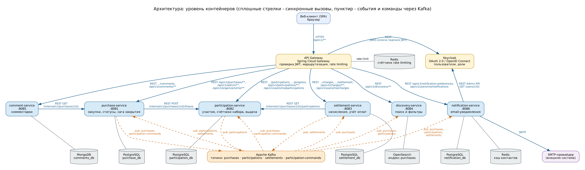
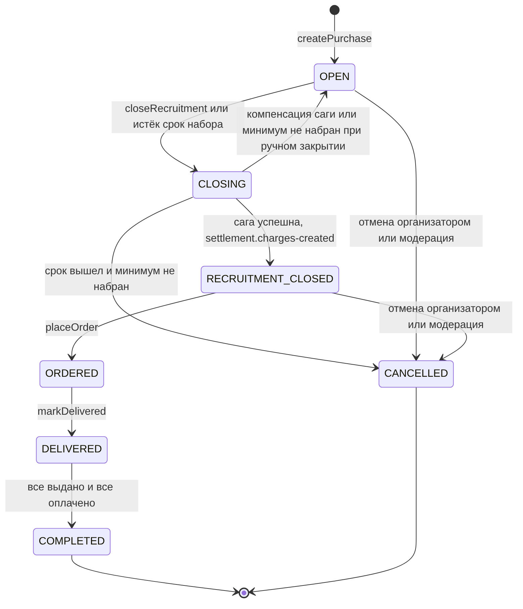
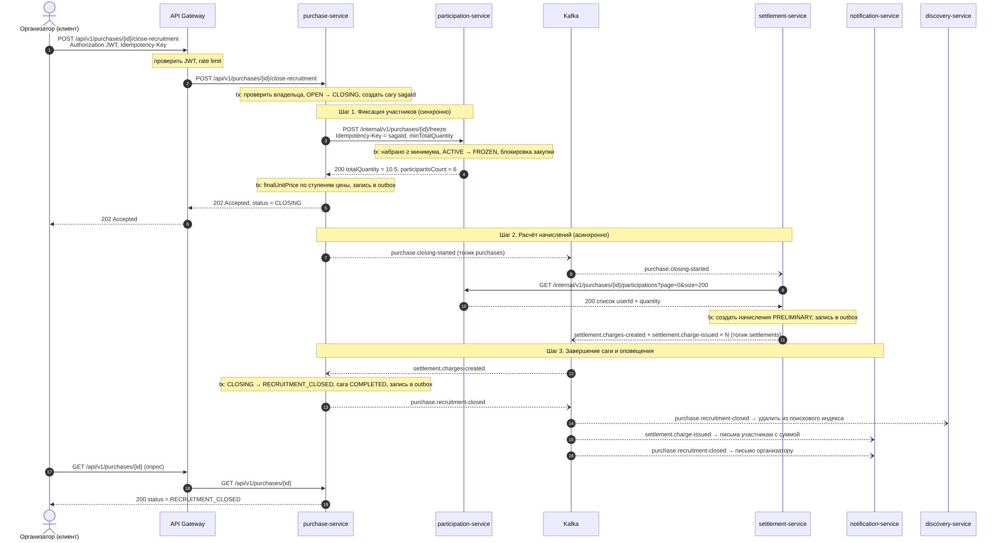
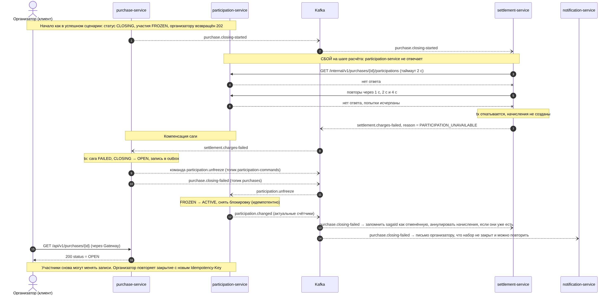
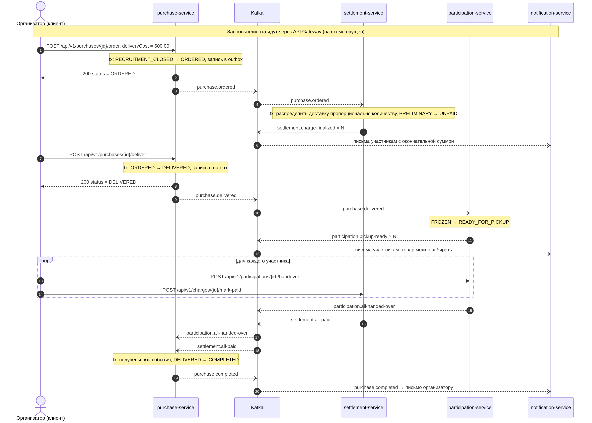

# Веб-сервис для организации совместных покупок: микросервисная архитектура

Лабораторная работа №3. Декомпозиция и проектирование микросервисной системы.
Студент: Калабухова Мария, группа ВПР42. Исходное ТЗ: «Разработка веб-сервиса для организации совместных покупок».

Состав репозитория:

```
project/
├── README.md                                  # этот отчёт
├── docs/
│   ├── architecture.drawio                    # исходник архитектурной схемы (draw.io)
│   ├── architecture.png                       # экспорт схемы
│   ├── architecture.dot                       # то же описание в Graphviz
│   ├── sequence-1-close-recruitment-success.{mmd,png}
│   ├── sequence-2-close-recruitment-failure.{mmd,png}
│   ├── sequence-3-order-delivery-completion.{mmd,png}
│   └── purchase-status.{mmd,png}              # диаграмма статусов закупки
├── api/
│   ├── purchase-service.yaml
│   ├── participation-service.yaml
│   ├── settlement-service.yaml
│   ├── discovery-service.yaml
│   ├── comment-service.yaml
│   └── notification-service.yaml
└── tools/check_contracts.py                   # проверка контрактов (ссылки, примеры, согласованность событий)
```

Соответствие требованиям лабораторной:

| Требование | Как выполнено |
| --- | --- |
| 4–7 бизнес-сервисов | 6: purchase, participation, settlement, discovery, comment, notification |
| ≥ 3 синхронных взаимодействий между сервисами | 3 межсервисных REST-вызова (purchase → participation, settlement → participation, comment → purchase) и запрос notification → Keycloak Admin API, см. раздел 4.2 |
| ≥ 2 асинхронных через брокер | 20 типов сообщений в Kafka (19 событий и 1 команда), см. раздел 5.3 |
| Сценарий на ≥ 3 сервиса с согласованностью и описанием сбоев | сага «закрытие набора»: purchase + participation + settlement, разбор сбоев на каждом шаге в разделе 4.5 |
| Своё хранилище у каждого сервиса | раздел 3, общих баз нет |
| Клиент только через API Gateway | раздел 4.3, `/internal/**` через Gateway не маршрутизируется |

---

## 1. Анализ предметной области

### 1.1. Что делает система

Веб-сервис объединяет людей (соседей по общежитию, семью, коллег, друзей), которые хотят купить товар оптом. Организатор (байер) создаёт закупку с оптовой ценой, минимальным объёмом и сроком набора, участники записываются на нужное количество. Когда набран минимальный объём, организатор закрывает набор, оформляет заказ у поставщика, раздаёт товар и отмечает оплаты. Система считает, кто сколько должен (в том числе с распределением доставки), показывает прогресс набора и статус закупки. Онлайн-оплаты в проекте нет: деньги передаются организатору напрямую, сервис только учитывает статусы.

### 1.2. Акторы

| Актор | Тип | Что делает |
| --- | --- | --- |
| Организатор (ORGANIZER) | пользователь | создаёт закупку, следит за набором, закрывает набор, оформляет заказ, отмечает выдачу и оплаты, отменяет закупку |
| Участник (PARTICIPANT) | пользователь | ищет закупки, записывается на количество, меняет и отменяет участие до закрытия набора, видит свою сумму и статус, комментирует |
| Администратор (ADMIN) | пользователь | управляет пользователями (консоль Keycloak), отменяет закупки по результатам модерации, удаляет комментарии |
| Keycloak | внешняя система (развёртывается нами) | регистрация, вход, токены, роли |
| SMTP-провайдер | внешняя система | доставка email-писем |

Один человек может иметь обе роли PARTICIPANT и ORGANIZER. «Организатор закупки» всегда конкретный пользователь, создавший её; права на действия с закупкой проверяются по роли и по владению.

### 1.3. Пользовательские сценарии

1. Как организатор, я хочу создать закупку (товар, оптовая и розничная цена, ступени цены, минимальный объём, срок набора, место выдачи), чтобы собрать участников.
2. Как участник, я хочу искать открытые закупки по названию и фильтрам (категория, место выдачи, цена, срок), чтобы выбрать подходящую.
3. Как участник, я хочу записаться на нужное количество и видеть прогресс набора («набрано 7 из 10 кг») и свою ориентировочную сумму, чтобы понимать, состоится ли закупка и сколько платить.
4. Как участник, я хочу изменить или отменить своё участие до закрытия набора, чтобы не платить за ненужное.
5. Как организатор, я хочу закрыть набор и получить расчёт суммы по каждому участнику, чтобы оформить заказ у поставщика.
6. Как организатор, я хочу указать стоимость доставки при оформлении заказа, чтобы она справедливо распределилась между участниками пропорционально количеству.
7. Как организатор, я хочу отмечать выдачу товара и оплату каждого участника, чтобы закупка завершилась и никто не остался должен.
8. Как администратор, я хочу отменять закупки, нарушающие правила, и управлять пользователями, чтобы поддерживать порядок.

Из блока «по возможности»: участник получает email на ключевых этапах (суммы, можно забирать, отмена); участники и организатор обсуждают закупку в комментариях.

### 1.4. Доменные события (упрощённый Event Storming)

| Контекст | События |
| --- | --- |
| Закупки | ЗакупкаСоздана, ЗакупкаИзменена, МинимальныйОбъёмНабран, ЗакрытиеНабораНачато, ЦенаЗафиксирована, НаборЗакрыт, ЗакрытиеНабораОткатано, ЗаказОформлен, ТоварДоставлен, ЗакупкаЗавершена, ЗакупкаОтменена |
| Участие | УчастникЗаписался, КоличествоИзменено, УчастиеОтменено, УчастникиЗафиксированы, УчастникиРазморожены, ТоварГотовКВыдаче, ТоварВыдан, ВсеТоварыВыданы |
| Расчёты | НачисленияСозданы, НачисленияНеСозданы, ДоставкаРаспределена, ОплатаОтмечена, ОтметкаОбОплатеСнята, ВсеОплатыУчтены, НачисленияАннулированы |
| Поиск | ЗакупкаДобавленаВИндекс, ЗакупкаУдаленаИзИндекса |
| Обсуждение | КомментарийДобавлен, КомментарийИзменён, КомментарийУдалён |
| Уведомления | ПисьмоОтправлено, ОтправкаНеУдалась |
| Идентификация (Keycloak) | ПользовательЗарегистрирован, РольНазначена |

### 1.5. Ограниченные контексты и глоссарии

Одно и то же слово означает разное в разных контекстах. «Закупка» для контекста закупок это агрегат с ценами, ступенями и статусами; для участия - только копия с шагом количества, лимитами и сроком; для расчётов - идентификатор, название и организатор; для поиска - плоский документ с прогрессом. Поэтому единой общей сущности «Закупка» на всю систему нет: у каждого контекста своя модель.

**Закупки (purchase-service)**

| Термин | Значение в контексте |
| --- | --- |
| Закупка | предложение организатора купить товар оптом: цены, минимальный объём, срок, место выдачи, статус |
| Ступень цены | пара «с какого набранного объёма» и «цена за единицу»; чем больше набрано, тем ниже цена |
| Набор | период, пока закупка в статусе OPEN и принимает участников |
| Закрытие набора | переход, после которого состав участников и цена за единицу фиксируются |
| Организатор | пользователь, создавший закупку и отвечающий за неё |

**Участие (participation-service)**

| Термин | Значение в контексте |
| --- | --- |
| Участие | запись пользователя на количество товара в конкретной закупке; одно активное участие на пару «пользователь + закупка» |
| Прогресс набора | суммарное количество и число участников по закупке |
| Заморозка (FROZEN) | состояние участия после закрытия набора: количество изменить или отменить нельзя |
| Выдача | отметка организатора, что товар передан участнику |
| Снимок закупки | локальная копия данных закупки, нужная для проверки правил записи |

**Расчёты (settlement-service)**

| Термин | Значение в контексте |
| --- | --- |
| Начисление | сумма, которую участник должен организатору по закупке |
| Предварительное / окончательное | предварительное создаётся при закрытии набора без доставки, окончательное после оформления заказа с долей доставки |
| Доля доставки | часть стоимости доставки, пропорциональная количеству участника |
| Отметка об оплате | ручная отметка организатора, что участник заплатил |
| Сводка расчётов | итоги по закупке: начислено, оплачено, сколько должников |

**Поиск (discovery-service)**

| Термин | Значение в контексте |
| --- | --- |
| Документ индекса | плоская запись об открытой закупке для поиска |
| Фасет | значение фильтра с количеством подходящих закупок |
| Релевантность | степень совпадения поисковой строки с названием и описанием |
| Перестроение индекса | пересборка индекса повторным чтением топиков Kafka |

**Обсуждение (comment-service)**

| Термин | Значение в контексте |
| --- | --- |
| Комментарий | сообщение пользователя к закупке |
| Ответ | комментарий с `parentId`, один уровень вложенности |
| Мягкое удаление | текст заменяется пометкой, ветка ответов сохраняется |
| Курсор | непрозрачная позиция в списке для постраничного чтения |

**Уведомления (notification-service)**

| Термин | Значение в контексте |
| --- | --- |
| Уведомление | письмо конкретному получателю по конкретному событию |
| Получатель | пользователь, чей email берётся из Keycloak |
| Настройки | включённые и выключенные группы писем у пользователя |
| Журнал | запись о каждой попытке отправки: статус, число попыток |

Идентификация (пользователи, роли, вход) вынесена в готовый Keycloak: собственный сервис пользователей не пишется.

---

## 2. Сервисы

Пять бизнес-контекстов превращены в отдельные сервисы, шестой (обсуждение) выделен из-за другого профиля данных. Авторизацию выполняет Keycloak, API Gateway в число бизнес-сервисов не входит.

### 2.1. purchase-service

| Поле | Значение |
| --- | --- |
| Название | purchase-service |
| Ответственность | жизненный цикл закупки и её статусы, ступенчатые цены, модерация; оркестратор саги закрытия набора |
| Владеет данными | Закупка, Ступени цены, состояние саги, outbox, обработанные eventId |
| Предоставляет | REST: создание, чтение, изменение, закрытие набора, заказ, доставка, отмена, список для организатора, модерация, `GET /internal/v1/purchases/{id}`. События: `purchase.*` (10 типов), команда `participation.unfreeze` |
| Зависит от | sync: participation-service (`freeze`). async: `participation.changed`, `participation.all-handed-over`, `settlement.charges-created`, `settlement.charges-failed`, `settlement.all-paid` |
| Нефункциональные требования | до 5 RPS записи и до 30 RPS чтения карточек; p95 < 300 мс; закрытие набора не должно терять и дублировать состояние при сбоях (сага + outbox); доступность 99,5% |
| Обоснование границы | бизнес-возможность «управлять закупкой» с единым владельцем статусов; сложная логика статусов и саги меняется независимо от записи участников; владелец данных о закупке один, остальные получают копии по событиям |

### 2.2. participation-service

| Поле | Значение |
| --- | --- |
| Название | participation-service |
| Ответственность | запись на количество, изменение и отмена участия, прогресс набора, фиксация участников при закрытии, учёт выдачи товара |
| Владеет данными | Участие, счётчики набора по закупке, блокировка закупки, локальный снимок закупки, outbox, обработанные eventId |
| Предоставляет | REST: запись, список участников, прогресс, мои участия, изменение, отмена, отметка выдачи; internal: `freeze`, список зафиксированных участий. События: `participation.changed`, `participation.pickup-ready`, `participation.cancelled`, `participation.all-handed-over` |
| Зависит от | sync: нет. async: `purchase.published/updated/ordered/delivered/cancelled`, команда `participation.unfreeze` |
| Нефункциональные требования | самый нагруженный на запись: пики перед концом срока набора до 50 RPS; p95 < 200 мс; строгая корректность счётчиков при гонках (блокировка строки закупки); работает без синхронных вызовов других сервисов |
| Обоснование границы | высокая нагрузка на запись масштабируется отдельно от остальных; владеет сущностью «Участие» и счётчиками; автономность: правила записи проверяются по локальному снимку закупки; если слить с purchase-service, каждая запись конкурировала бы с изменением статусов закупки |

### 2.3. settlement-service

| Поле | Значение |
| --- | --- |
| Название | settlement-service |
| Ответственность | начисления участникам, распределение доставки, ручной учёт оплат, сводка по закупке |
| Владеет данными | Начисление, состояния саг (sagaId → статус, нужны для запоздавших сообщений), локальные данные о закупке (организатор, название), outbox, обработанные eventId |
| Предоставляет | REST: мои начисления, начисление, начисления закупки, сводка, отметить оплату, снять отметку. События: `settlement.charges-created`, `settlement.charges-failed`, `settlement.charge-issued`, `settlement.charge-finalized`, `settlement.all-paid` |
| Зависит от | sync: participation-service (`GET /internal/v1/purchases/{id}/participations`). async: `purchase.published/updated/closing-started/closing-failed/ordered/delivered/cancelled` |
| Нефункциональные требования | низкая нагрузка (до 5 RPS), но высокая цена ошибки: деньги, округление до копейки, сумма долей доставки точно равна стоимости доставки; полная история изменений (аудит) |
| Обоснование границы | отдельная бизнес-возможность «учёт денег» с собственными правилами округления и аудита; в будущем может обрасти платёжным шлюзом (ТЗ допускает тестовую страницу оплаты) без изменения остальных сервисов; не должна зависеть от частых изменений закупок |

### 2.4. discovery-service

| Поле | Значение |
| --- | --- |
| Название | discovery-service |
| Ответственность | полнотекстовый поиск и фильтры по открытым закупкам |
| Владеет данными | поисковый индекс (производные данные: источником истины остаются purchase-service и participation-service) |
| Предоставляет | REST: поиск, фасеты; internal: перестроение индекса |
| Зависит от | async: `purchase.published/updated/recruitment-closed/cancelled`, `participation.changed` |
| Нефункциональные требования | чтение в десятки раз чаще записи: до 100 RPS; p95 < 150 мс; допустимая задержка актуальности индекса до 2 секунд; русская морфология |
| Обоснование границы | другой профиль нагрузки (почти только чтение) и другая технология хранения; масштабируется независимо; его отказ не мешает записываться и закрывать набор, потому что карточка закупки по прямой ссылке остаётся доступной |

### 2.5. comment-service

| Поле | Значение |
| --- | --- |
| Название | comment-service |
| Ответственность | комментарии к закупкам, ответы, редактирование в течение 15 минут, удаление |
| Владеет данными | Комментарий |
| Предоставляет | REST: список (курсорная пагинация), добавить, изменить, удалить |
| Зависит от | sync: purchase-service (`GET /internal/v1/purchases/{id}`) при добавлении и удалении организатором. async: нет |
| Нефункциональные требования | до 20 RPS, p95 < 200 мс; недоступность не должна влиять на основной процесс закупки |
| Обоснование границы | документная модель с веткой ответов и свободным текстом не связана с транзакциями закупки; независимая масштабируемость; сбой сервиса не ломает ни набор, ни расчёты |

### 2.6. notification-service

| Поле | Значение |
| --- | --- |
| Название | notification-service |
| Ответственность | email-уведомления участникам и организаторам, настройки уведомлений, журнал отправок |
| Владеет данными | Уведомление (журнал), Настройки пользователя, обработанные пары (eventId, userId) |
| Предоставляет | REST: настройки, мой журнал уведомлений |
| Зависит от | sync: Keycloak Admin API (email по userId, кэш в Redis на 1 час), SMTP. async: 9 типов событий из `purchases`, `participations`, `settlements` |
| Нефункциональные требования | пик до нескольких сотен писем при закрытии набора крупной закупки; задержка до нескольких минут допустима; повторы отправки и dead letter queue |
| Обоснование границы | не влияет на основной сценарий, его сбой не должен ломать закупку (только асинхронная связь); интеграция с внешним SMTP и шаблоны писем меняются независимо |

### 2.7. От каких вариантов разбиения отказались

| Вариант | Почему отказались |
| --- | --- |
| Объединить закупки и участие в один сервис | Агрегат «закупка + участники» естественный, но запись участников пикует перед дедлайном и конкурирует за счётчики, а статусы закупки меняются редко и сложно. Разделение даёт независимое масштабирование. Цена решения: двусторонняя зависимость. Смягчена так: запись проверяется по локальному снимку (без вызова purchase-service), единственный синхронный вызов purchase → participation происходит при закрытии набора и защищён идемпотентностью |
| Отдельный pricing-service для ступенчатых цен | «Сервис на одну функцию»: ступени цены меняются вместе с закупкой и не имеют самостоятельной ценности; остаётся частью purchase-service |
| Объединить расчёты и закупки | Деньги требуют своих правил округления, аудита и отдельного жизненного цикла (оплата отмечается в другое время и другим действием). Объединение смешало бы статусы закупки и статусы оплат |
| Отдельный сервис профилей пользователей | Пользователи и роли в Keycloak; иначе получился бы «сервис на таблицу» без бизнес-логики. Имя и email берутся из токена и Admin API |
| Комментарии внутри purchase-service | Другой тип данных и нагрузки, сбой обсуждения не должен влиять на закупки |
| Хореография без оркестратора для закрытия набора | Участвуют три сервиса и нужны компенсации; оркестратор (purchase-service) хранит состояние саги и сам инициирует откат, это проще сопровождать и видеть, на каком шаге сага застряла |
| Поиск средствами PostgreSQL (tsvector) в purchase-service | Для масштаба одного общежития этого хватило бы. OpenSearch выбран ради русской морфологии, фасетов и изоляции чтения от записи; если его эксплуатация окажется тяжёлой, допустимая замена - PostgreSQL FTS внутри discovery-service, контракт API при этом не меняется |

---

## 3. Выбранное ПО

| Компонент | Какие сервисы используют | Обоснование |
| --- | --- | --- |
| PostgreSQL (отдельная база и отдельный пользователь на сервис) | purchase, participation, settlement, notification | purchase: статусы, сага и outbox требуют транзакций; participation: корректные счётчики набора через блокировку строки (`SELECT ... FOR UPDATE`) и уникальный индекс «пользователь + закупка»; settlement: деньги, округление, ограничения целостности, аудит; notification: журнал с уникальностью `(eventId, userId)` для идемпотентности. В dev допускается один сервер PostgreSQL с четырьмя базами и разными учётными записями; доступа между базами нет |
| MongoDB | comment | комментарий читается целиком одной выборкой по `purchaseId`, схема гибкая (ответы, будущие вложения), нет связей между сущностями и многотабличных транзакций |
| OpenSearch | discovery | полнотекстовый поиск с русской морфологией, фильтры по нескольким полям, фасеты и сортировка по прогрессу; Elasticsearch не взят из-за лицензии, OpenSearch распространяется под Apache 2.0 |
| Redis | API Gateway, notification | Gateway: счётчики rate limiting между экземплярами; notification: кэш email получателей (TTL 1 час) снижает число обращений к Keycloak Admin API. Два независимых экземпляра или две логические БД |
| Apache Kafka (режим KRaft) | purchase, participation, settlement, discovery, notification | события читают несколько независимых подписчиков (`purchase.*` слушают пять сервисов); ключ `purchaseId` сохраняет порядок событий закупки; хранение лога позволяет перестроить индекс discovery повторным чтением и пережить недоступность получателя. Команда `participation.unfreeze` тоже идёт через Kafka, отдельный RabbitMQ ради одной команды не нужен |
| Spring Cloud Gateway | клиент | единая точка входа, маршрутизация по префиксам путей, проверка JWT по JWKS Keycloak, rate limiting на Redis; решение независимо от языка бизнес-сервисов, это отдельный контейнер. Допустимая замена: Envoy с фильтром `jwt_authn` |
| Keycloak | Gateway, все сервисы, notification | регистрация, вход, роли PARTICIPANT, ORGANIZER, ADMIN, OAuth 2.0 / OIDC без собственной реализации; консоль Keycloak закрывает «управление пользователями» администратора; сервисные аккаунты (client credentials) защищают `/internal/**` |
| SMTP-провайдер (в разработке Mailpit) | notification | внешняя система доставки писем, подменяется тестовым сервером |

Не выбрано: объектное хранилище (MinIO/S3) - в ТЗ нет загрузки файлов и изображений. Брокер RabbitMQ - не нужен, всё покрывается Kafka. Отдельный Debezium для outbox не используется: каждый сервис публикует outbox фоновым потоком раз в 200 мс.

---

## 4. Схема взаимодействий

### 4.1. Архитектурная схема (уровень контейнеров)



Исходник: [docs/architecture.drawio](docs/architecture.drawio). Сплошные стрелки - синхронные вызовы с протоколом и эндпоинтом, пунктирные - события и команды с названиями топиков (`pub` публикует, `sub` подписан).

### 4.2. Таблица синхронных взаимодействий

| № | Инициатор → получатель | Эндпоинт | Назначение |
| --- | --- | --- | --- |
| 1 | клиент → purchase | `POST /api/v1/purchases` | создать закупку |
| 2 | клиент → discovery | `GET /api/v1/discovery/purchases` | поиск и фильтры |
| 3 | клиент → participation | `POST /api/v1/purchases/{id}/participations` | записаться |
| 4 | клиент → purchase | `POST /api/v1/purchases/{id}/close-recruitment` | закрыть набор, запуск саги |
| 5 | клиент → settlement | `POST /api/v1/charges/{id}/mark-paid` | отметить оплату |
| 6 | клиент → comment | `POST /api/v1/purchases/{id}/comments` | добавить комментарий |
| 7 | **purchase → participation** | `POST /internal/v1/purchases/{id}/freeze` | зафиксировать участников и проверить минимум |
| 8 | **settlement → participation** | `GET /internal/v1/purchases/{id}/participations` | получить зафиксированные участия для расчёта |
| 9 | **comment → purchase** | `GET /internal/v1/purchases/{id}` | проверить, что закупка принимает комментарии, узнать организатора |
| 10 | notification → Keycloak | `GET /admin/realms/{realm}/users/{userId}` | получить email получателя |
| 11 | Gateway → Keycloak | JWKS endpoint | ключи для проверки подписи JWT |

Строки 7–9 это межсервисные REST-вызовы. Все они тоже защищены таймаутом 2 секунды, не более двух повторов и circuit breaker. Цепочек длиннее одного вызова нет.

### 4.3. Маршрутизация в API Gateway

Правила проверяются сверху вниз, первое совпадение побеждает. Gateway проверяет JWT (подпись, срок, аудиторию), ограничивает 120 запросов в минуту на пользователя (счётчики в Redis) и передаёт токен дальше; сервисы проверяют его повторно и сами проверяют роль и владение ресурсом.

| Путь | Сервис |
| --- | --- |
| `/api/v1/purchases/*/participations`, `/api/v1/purchases/*/progress` | participation-service |
| `/api/v1/purchases/*/charges`, `/api/v1/purchases/*/settlement` | settlement-service |
| `/api/v1/purchases/*/comments` | comment-service |
| `/api/v1/purchases/**`, `/api/v1/organizers/**`, `/api/v1/admin/**` | purchase-service |
| `/api/v1/participations/**`, `/api/v1/users/me/participations` | participation-service |
| `/api/v1/charges/**`, `/api/v1/users/me/charges` | settlement-service |
| `/api/v1/comments/**` | comment-service |
| `/api/v1/discovery/**` | discovery-service |
| `/api/v1/notification-preferences`, `/api/v1/users/me/notifications` | notification-service |
| `/internal/**` | не маршрутизируется (404 на Gateway) |

Права по ролям:

| Роль | Что может |
| --- | --- |
| PARTICIPANT | искать, записываться и менять свои участия, видеть свои начисления, комментировать |
| ORGANIZER | всё, что PARTICIPANT, плюс создавать закупки и управлять своими: закрывать набор, заказ, доставка, выдача, оплата, отмена |
| ADMIN | список всех закупок, отмена по модерации, удаление комментариев; пользователи - в консоли Keycloak |

### 4.4. Статусы закупки



Соответствие статусам из ТЗ: «Открыта» это `OPEN` и техническое `CLOSING` (идёт сага), «Набор завершён» - `RECRUITMENT_CLOSED`, «Заказано» - `ORDERED`, «Доставлено» - `DELIVERED`, «Завершена» - `COMPLETED`, «Отменена» - `CANCELLED`.
Набор закрывается вручную организатором (когда минимум набран) или автоматически по истечении срока: если минимум набран, запускается та же сага, иначе закупка отменяется с причиной `MIN_VOLUME_NOT_REACHED`.

### 4.5. Основной сквозной сценарий: закрытие набора

Затрагивает три сервиса и требует согласованности: purchase-service меняет статус, participation-service фиксирует участников, settlement-service создаёт начисления. Распределённой транзакции нет, используется **сага с оркестратором purchase-service**. Каждая локальная транзакция записывает исходящее событие в таблицу outbox, откуда его публикует фоновый поток.

**Успешный путь.** Исходник: [sequence-1-close-recruitment-success.mmd](docs/sequence-1-close-recruitment-success.mmd).



1. Организатор вызывает `close-recruitment`, purchase-service переводит закупку `OPEN → CLOSING` и создаёт сагу.
2. purchase-service синхронно вызывает `freeze`: participation-service в одной транзакции проверяет, что набран минимум, переводит участия `ACTIVE → FROZEN` и блокирует закупку для записи.
3. purchase-service определяет цену за единицу по ступеням и публикует `purchase.closing-started`, организатор получает `202`.
4. settlement-service получает событие, читает зафиксированные участия и в одной транзакции создаёт начисления `PRELIMINARY`, публикует `settlement.charges-created` и `settlement.charge-issued` по каждому участнику.
5. purchase-service получает `settlement.charges-created`, переводит закупку в `RECRUITMENT_CLOSED` и публикует `purchase.recruitment-closed`: discovery убирает закупку из индекса, notification отправляет письма участникам и организатору.

**Сбой и компенсация.** Исходник: [sequence-2-close-recruitment-failure.mmd](docs/sequence-2-close-recruitment-failure.mmd). На схеме participation-service перестаёт отвечать settlement-service на шаге расчёта.



Компенсирующие действия: статус закупки возвращается в `OPEN`, участия возвращаются `FROZEN → ACTIVE` командой `participation.unfreeze`, начисления не создаются (откат транзакции) либо аннулируются по `purchase.closing-failed`, организатор получает письмо и может повторить закрытие.

**Что произойдёт при сбое на любом шаге:**

| Шаг и сбой | Поведение системы |
| --- | --- |
| Клиент повторил запрос закрытия (таймаут, двойной клик) | тот же `Idempotency-Key` возвращает тот же ответ; новый ключ при статусе `CLOSING` вернёт `409 INVALID_STATE` |
| purchase-service упал после перевода в `CLOSING`, до вызова `freeze` | фоновая задача каждые 30 секунд находит саги в `CLOSING` старше 60 секунд и продолжает с шага 2; `freeze` идемпотентен по `sagaId` |
| `freeze`: participation-service не ответил (таймаут 2 с, 2 повтора, circuit breaker) | сага `FAILED`, статус возвращается в `OPEN`, организатор получает `503 DEPENDENCY_UNAVAILABLE`; если `freeze` на самом деле выполнился, отправляется команда `participation.unfreeze` |
| `freeze`: набрано меньше минимума | при ручном закрытии: статус `OPEN`, ответ `409 MIN_VOLUME_NOT_REACHED`, ничего не изменилось; по истечении срока: закупка `CANCELLED`, событие `purchase.cancelled`, все участия отменяются, участники получают письма |
| purchase-service упал после `freeze`, до фиксации цены | транзакция не закоммичена, задача восстановления повторяет `freeze` и получает тот же результат, дублей нет |
| Kafka недоступна при публикации | событие уже записано в outbox той же транзакцией, что и изменение состояния; будет опубликовано после восстановления |
| settlement-service недоступен или отстаёт | сообщение ждёт в Kafka; если за 10 минут нет `charges-created`, purchase-service повторно публикует `closing-started` (до 3 раз), затем компенсирует с причиной `SETTLEMENT_TIMEOUT` |
| settlement-service не получил участников (см. схему) | `settlement.charges-failed`, компенсация как на схеме |
| `closing-started` доставлено дважды | settlement-service хранит обработанные `eventId` и имеет уникальность по `sagaId`; повтор игнорируется |
| `charges-created` пришло после того, как сага уже откатилась | purchase-service игнорирует (сага `FAILED`); settlement-service, получив `closing-failed`, аннулирует начисления; итог согласован: участия `ACTIVE`, закупка `OPEN`, начисления `VOIDED` |
| `closing-failed` пришло в settlement-service раньше `closing-started` (порядок между разными событиями не гарантирован) | `sagaId` записывается как отменённая, запоздавшее `closing-started` игнорируется |
| Участник меняет или отменяет участие во время закрытия | `409 PURCHASE_LOCKED`, блокировка стоит с момента `freeze` |
| Команда `participation.unfreeze` задержалась | хранится в Kafka и выполняется при доставке (идемпотентна); до выполнения запись блокирована, при задержке больше 5 минут срабатывает оповещение |
| Одновременная запись на последние единицы лимита `maxTotalQuantity` | счётчик закупки обновляется под блокировкой строки, второй запрос получает `409 LIMIT_EXCEEDED` |
| notification-service недоступен | на сагу не влияет; сообщения повторяются до 3 раз, затем уходят в `<topic>.dlq` |

### 4.6. Второй сценарий: заказ, выдача, оплата, завершение

Исходник: [sequence-3-order-delivery-completion.mmd](docs/sequence-3-order-delivery-completion.mmd).



После `purchase.ordered` settlement-service распределяет доставку и переводит начисления в `UNPAID` (окончательные); отметка оплаты до этого момента невозможна (`409 CHARGE_NOT_FINAL`). Закупка становится `COMPLETED`, когда purchase-service получил **оба** условия: `participation.all-handed-over` и `settlement.all-paid`, порядок их прихода не важен. Если организатор снял отметку об оплате после `all-paid`, а закупка ещё не `COMPLETED`, при повторном `all-paid` ничего дублироваться не будет.

---

## 5. Контракты API

### 5.1. Файлы

| Сервис | OpenAPI | Операций |
| --- | --- | --- |
| purchase-service | [api/purchase-service.yaml](api/purchase-service.yaml) | 12 |
| participation-service | [api/participation-service.yaml](api/participation-service.yaml) | 10 |
| settlement-service | [api/settlement-service.yaml](api/settlement-service.yaml) | 6 |
| discovery-service | [api/discovery-service.yaml](api/discovery-service.yaml) | 3 |
| comment-service | [api/comment-service.yaml](api/comment-service.yaml) | 4 |
| notification-service | [api/notification-service.yaml](api/notification-service.yaml) | 3 |

Внешние эндпоинты помечены тегом `public` (для админов `admin`), внутренние - `internal`. Схемы событий лежат в `components/schemas` спецификации сервиса-издателя; в корне каждой спецификации расширения `x-async-messages` (что публикует сервис) и `x-consumed-messages` (что потребляет и что с этим делает).

### 5.2. Общие соглашения

| Тема | Решение |
| --- | --- |
| Версионирование | `/api/v1/...` для клиента, `/internal/v1/...` для сервисов |
| Модель ошибок | единая во всех сервисах: `application/problem+json` (RFC 9457) с полями `type`, `title`, `status`, `code`, `detail`, `instance`, `traceId`, `errors[]` |
| Идемпотентность | заголовок `Idempotency-Key` (UUID) обязателен для создания закупки, записи на закупку, закрытия набора, оформления заказа, добавления комментария и вызова `freeze` (там ключ равен `sagaId`). Тот же ключ и то же тело возвращают результат первого вызова, тот же ключ с другим телом - `409 IDEMPOTENCY_KEY_REUSED`; ключи хранятся 24 часа. Операции вида «установить статус» (`mark-paid`, `handover`, `deliver`) идемпотентны по природе. Для сообщений Kafka: `eventId` для дедупликации, `correlationId` для сквозной операции (равен `sagaId` у саги) |
| Пагинация | `page` (с 0) и `size` (1–100, по умолчанию 20) для списков; курсор (`cursor`, `limit`, `nextCursor`) для комментариев |
| Деньги | объект `{ "amount": "1250.00", "currency": "RUB" }`, сумма строкой с двумя знаками |
| Количество | число, кратное `quantityStep` закупки; единицы `PCS, KG, G, L, ML, PACK` |
| Время | UTC, формат RFC 3339 (`2026-11-20T18:00:00Z`) |
| Безопасность | Bearer JWT от Keycloak для `/api/**`; токен сервисного аккаунта с ролью `internal-service` для `/internal/**` |

Справочник кодов ошибок:

| `code` | HTTP | Когда |
| --- | --- | --- |
| `VALIDATION_ERROR` | 400 | неверные поля запроса |
| `UNAUTHORIZED` | 401 | нет или просрочен токен |
| `FORBIDDEN` | 403 | не та роль или не владелец ресурса |
| `NOT_FOUND` | 404 | ресурс не существует |
| `INVALID_STATE` | 409 | операция недопустима в текущем статусе |
| `PURCHASE_NOT_OPEN` | 409 | запись на закупку не в статусе `OPEN` или срок вышел |
| `PURCHASE_LOCKED` | 409 | идёт закрытие набора, участие менять нельзя |
| `PARTICIPATION_EXISTS` | 409 | у пользователя уже есть активное участие в закупке |
| `LIMIT_EXCEEDED` | 409 | превышен `maxTotalQuantity` |
| `MIN_VOLUME_NOT_REACHED` | 409 | при закрытии набрано меньше минимума |
| `PURCHASE_NOT_FROZEN` | 409 | запрос зафиксированных участий до `freeze` |
| `NOT_READY_FOR_PICKUP` | 409 | отметка выдачи до статуса `DELIVERED` |
| `CHARGE_NOT_FINAL` | 409 | отметка оплаты предварительного начисления |
| `COMMENTS_CLOSED` | 409 | комментарии к закупке `CANCELLED` или `COMPLETED` |
| `EDIT_WINDOW_EXPIRED` | 409 | прошло больше 15 минут с создания комментария |
| `IDEMPOTENCY_KEY_REUSED` | 409 | тот же `Idempotency-Key` с другим телом |
| `RATE_LIMITED` | 429 | превышен лимит запросов (отдаёт Gateway) |
| `DEPENDENCY_UNAVAILABLE` | 503 | зависимый сервис недоступен, можно повторить с тем же ключом |

### 5.3. Перечень событий и команд

Все сообщения идут в Kafka, ключ партиции - `purchaseId`, формат конверта: `eventId`, `eventType`, `schemaVersion`, `occurredAt`, `correlationId`, `payload`. Доставка «минимум один раз», потребители идемпотентны. Схема меняется только добавлением необязательных полей; при несовместимых изменениях растёт `schemaVersion`.

| Событие / команда | Топик | Издатель | Подписчики | Схема |
| --- | --- | --- | --- | --- |
| `purchase.published` | purchases | purchase | participation, settlement, discovery | [PurchasePublishedEvent](api/purchase-service.yaml) |
| `purchase.updated` | purchases | purchase | participation, settlement, discovery | [PurchaseUpdatedEvent](api/purchase-service.yaml) |
| `purchase.min-volume-reached` | purchases | purchase | notification | [PurchaseMinVolumeReachedEvent](api/purchase-service.yaml) |
| `purchase.closing-started` | purchases | purchase | settlement | [PurchaseClosingStartedEvent](api/purchase-service.yaml) |
| `purchase.closing-failed` | purchases | purchase | settlement, notification | [PurchaseClosingFailedEvent](api/purchase-service.yaml) |
| `purchase.recruitment-closed` | purchases | purchase | discovery, notification | [PurchaseRecruitmentClosedEvent](api/purchase-service.yaml) |
| `purchase.ordered` | purchases | purchase | settlement, participation | [PurchaseOrderedEvent](api/purchase-service.yaml) |
| `purchase.delivered` | purchases | purchase | participation, settlement | [PurchaseDeliveredEvent](api/purchase-service.yaml) |
| `purchase.completed` | purchases | purchase | notification | [PurchaseCompletedEvent](api/purchase-service.yaml) |
| `purchase.cancelled` | purchases | purchase | participation, settlement, discovery, notification | [PurchaseCancelledEvent](api/purchase-service.yaml) |
| `participation.unfreeze` (команда) | participation-commands | purchase | participation | [UnfreezeParticipationsCommand](api/purchase-service.yaml) |
| `participation.changed` | participations | participation | purchase, discovery | [ParticipationChangedEvent](api/participation-service.yaml) |
| `participation.pickup-ready` | participations | participation | notification | [ParticipationPickupReadyEvent](api/participation-service.yaml) |
| `participation.cancelled` | participations | participation | notification | [ParticipationCancelledEvent](api/participation-service.yaml) |
| `participation.all-handed-over` | participations | participation | purchase | [ParticipationAllHandedOverEvent](api/participation-service.yaml) |
| `settlement.charges-created` | settlements | settlement | purchase | [SettlementChargesCreatedEvent](api/settlement-service.yaml) |
| `settlement.charges-failed` | settlements | settlement | purchase | [SettlementChargesFailedEvent](api/settlement-service.yaml) |
| `settlement.charge-issued` | settlements | settlement | notification | [SettlementChargeIssuedEvent](api/settlement-service.yaml) |
| `settlement.charge-finalized` | settlements | settlement | notification | [SettlementChargeFinalizedEvent](api/settlement-service.yaml) |
| `settlement.all-paid` | settlements | settlement | purchase | [SettlementAllPaidEvent](api/settlement-service.yaml) |

Пример события `purchase.closing-started` (топик `purchases`, ключ `7c9e6679-...`, `correlationId` равен `sagaId`):

```json
{
  "eventId": "3f6c2b0e-8d1a-4c57-9e2f-5a1b7c9d0e44",
  "eventType": "purchase.closing-started",
  "schemaVersion": 1,
  "occurredAt": "2026-11-20T18:00:03Z",
  "correlationId": "5d2c7a10-3b9e-4f6a-8c11-2e7f90ab1c3d",
  "payload": {
    "purchaseId": "7c9e6679-7425-40de-944b-e07fc1f90ae7",
    "sagaId": "5d2c7a10-3b9e-4f6a-8c11-2e7f90ab1c3d",
    "totalQuantity": 10.5,
    "participantsCount": 6,
    "unitPrice": { "amount": "1150.00", "currency": "RUB" }
  }
}
```

### 5.4. Соответствие ТЗ

| Требование ТЗ | Где реализовано |
| --- | --- |
| Регистрация, вход, личный кабинет, роли | Keycloak; личный кабинет клиент собирает из `GET /api/v1/organizers/me/purchases`, `/api/v1/users/me/participations`, `/api/v1/users/me/charges` |
| Создание закупки (товар, описание, цены, минимальный объём, единица, срок, место выдачи) | purchase-service, `POST /api/v1/purchases` |
| Список открытых закупок с поиском и фильтрами | discovery-service, `GET /api/v1/discovery/purchases` |
| Запись, изменение, отмена участия до закрытия набора | participation-service, `POST` на `/purchases/{id}/participations`, `PATCH` и `DELETE` на `/participations/{id}` |
| Прогресс набора («7 из 10 кг») | participation-service, `GET /api/v1/purchases/{id}/progress` |
| Автоматический расчёт суммы (количество × цена, доставка пропорционально) | settlement-service; ориентировочная сумма до закрытия в поле `estimatedAmount` участия |
| Учёт оплат «не оплачено / оплачено» вручную | settlement-service, `mark-paid`, `mark-unpaid` |
| Статусы закупки | purchase-service, схема статусов 4.4 |
| История закупок и участия | списки «мои» в purchase, participation, settlement |
| Ступенчатые оптовые цены | поле `priceTiers` закупки, `nextTier` в прогрессе |
| Уведомления на email | notification-service |
| Комментарии к закупке | comment-service |
| Администратор: пользователи и модерация | консоль Keycloak и `POST /api/v1/admin/purchases/{id}/cancel` |
| Не входит: онлайн-оплата картой | не реализуется; граница расчётов в settlement-service позволяет позже добавить платёжный шлюз или тестовую страницу оплаты |

### 5.5. Проверка контрактов

Спецификации написаны в формате OpenAPI 3.1. Проверка линтером и просмотр:

```bash
npx @redocly/cli lint api/*.yaml
npx @stoplight/spectral-cli lint api/*.yaml --ruleset spectral:oas   # при наличии правил
```

Файлы можно открыть в Swagger Editor (https://editor.swagger.io): File → Import file. Дополнительно в репозитории лежит `tools/check_contracts.py`: проверяет, что все `$ref` разрешаются, примеры соответствуют схемам, `operationId` уникальны, а публикуемые и потребляемые события во всех файлах согласованы между собой (кто издатель, кто подписчик).

```bash
pip install pyyaml
python tools/check_contracts.py api
```

---

## 6. Допущения

1. Нагрузка в карточках сервисов оценочная (общежитие, несколько сотен пользователей и десятки открытых закупок одновременно), на её основе выбраны размеры и аргументы разделения, но не размеры кластеров.
2. Набор не закрывается автоматически при достижении минимума: организатор может ждать срока ради более низкой ступени цены. По истечении срока набор закрывается автоматически.
3. Организатор вручную учитывает оплаты, повторная онлайн-оплата и возвраты не поддерживаются (по ТЗ).
4. Отмена закупки после оформления заказа у поставщика невозможна: это решается между организатором и участниками вне сервиса.
5. В следующих лабораторных сервисы будут реализованы и развёрнуты по этим контрактам; при реализации контракты можно уточнять, сохраняя обратную совместимость.
